<!--
  Profile README — Théo Moitrier-Cabodi
  Visual plates live in assets/ and are generated by .github/scripts/build_assets.py.
  The activity card (assets/stats-*.svg) is refreshed daily by .github/workflows/profile-stats.yml.
-->

<picture>
  <source media="(max-width: 640px) and (prefers-color-scheme: dark)" srcset="assets/header-narrow-dark.svg">
  <source media="(max-width: 640px)" srcset="assets/header-narrow-light.svg">
  <source media="(prefers-color-scheme: dark)" srcset="assets/header-wide-dark.svg">
  
</picture>

  <a href="https://tmoitrier-cabodi.dev"><picture>
    <source media="(prefers-color-scheme: dark)" srcset="assets/btn-portfolio-dark.svg">
    
  </picture></a>
  &nbsp;
  <a href="https://www.linkedin.com/in/th%C3%A9o-moitrier-cabodi-3277552b1/"><picture>
    <source media="(prefers-color-scheme: dark)" srcset="assets/btn-linkedin-dark.svg">
    
  </picture></a>
  &nbsp;
  <a href="mailto:contact@tmoitrier-cabodi.dev"><picture>
    <source media="(prefers-color-scheme: dark)" srcset="assets/btn-email-dark.svg">
    
  </picture></a>

  
    <a href="#about-me">01&nbsp;About</a> &nbsp;/&nbsp;
    <a href="#what-i-work-on">02&nbsp;Work</a> &nbsp;/&nbsp;
    <a href="#technical-stack">03&nbsp;Stack</a> &nbsp;/&nbsp;
    <a href="#selected-engineering-interests">04&nbsp;Interests</a> &nbsp;/&nbsp;
    <a href="#engineering-approach">05&nbsp;Approach</a> &nbsp;/&nbsp;
    <a href="#github-activity">06&nbsp;Activity</a> &nbsp;/&nbsp;
    <a href="#lets-connect">07&nbsp;Contact</a>
  

 

## About me

I'm a French software developer working at the intersection of
**software engineering, application modernization, and industrial R&D**.

At **Mirion Technologies**, where I work as part of a work-study program while studying at **ESGI**,
I contribute to the improvement and modernization of existing software in demanding technical
environments. I enjoy understanding how systems actually work, identifying their weak points,
and making them more maintainable, reliable, and efficient.

<picture>
  <source media="(max-width: 640px) and (prefers-color-scheme: dark)" srcset="assets/identity-narrow-dark.svg">
  <source media="(max-width: 640px)" srcset="assets/identity-narrow-light.svg">
  <source media="(prefers-color-scheme: dark)" srcset="assets/identity-wide-dark.svg">
  
</picture>

 

## What I work on

<picture>
  <source media="(max-width: 640px) and (prefers-color-scheme: dark)" srcset="assets/scope-narrow-dark.svg">
  <source media="(max-width: 640px)" srcset="assets/scope-narrow-light.svg">
  <source media="(prefers-color-scheme: dark)" srcset="assets/scope-wide-dark.svg">
  
</picture>

 

## Technical stack

<picture>
  <source media="(max-width: 640px) and (prefers-color-scheme: dark)" srcset="assets/stack-narrow-dark.svg">
  <source media="(max-width: 640px)" srcset="assets/stack-narrow-light.svg">
  <source media="(prefers-color-scheme: dark)" srcset="assets/stack-wide-dark.svg">
  
</picture>

 

## Selected engineering interests

<picture>
  <source media="(max-width: 640px) and (prefers-color-scheme: dark)" srcset="assets/interests-narrow-dark.svg">
  <source media="(max-width: 640px)" srcset="assets/interests-narrow-light.svg">
  <source media="(prefers-color-scheme: dark)" srcset="assets/interests-wide-dark.svg">
  
</picture>

 

## Engineering approach

I particularly enjoy problems where **logic, constraints, and practical usefulness** come together.
I value clear reasoning, technical consistency, and solutions that serve a real purpose —
and I prefer understanding why a solution works rather than simply reproducing it.

<picture>
  <source media="(max-width: 640px) and (prefers-color-scheme: dark)" srcset="assets/approach-narrow-dark.svg">
  <source media="(max-width: 640px)" srcset="assets/approach-narrow-light.svg">
  <source media="(prefers-color-scheme: dark)" srcset="assets/approach-wide-dark.svg">
  
</picture>

These are the questions that guide the way I approach software development and technical learning:

<picture>
  <source media="(max-width: 640px) and (prefers-color-scheme: dark)" srcset="assets/review-narrow-dark.svg">
  <source media="(max-width: 640px)" srcset="assets/review-narrow-light.svg">
  <source media="(prefers-color-scheme: dark)" srcset="assets/review-wide-dark.svg">
  
</picture>

 

## GitHub activity

<picture>
  <source media="(max-width: 640px) and (prefers-color-scheme: dark)" srcset="assets/stats-narrow-dark.svg">
  <source media="(max-width: 640px)" srcset="assets/stats-narrow-light.svg">
  <source media="(prefers-color-scheme: dark)" srcset="assets/stats-wide-dark.svg">
  
</picture>

 

## Let's connect

I'm interested in software engineering, application modernization,
industrial R&D, and projects where technical decisions have a concrete impact.

  <a href="https://tmoitrier-cabodi.dev"><picture>
    <source media="(prefers-color-scheme: dark)" srcset="assets/btn-portfolio-dark.svg">
    
  </picture></a>
  &nbsp;
  <a href="https://www.linkedin.com/in/th%C3%A9o-moitrier-cabodi-3277552b1/"><picture>
    <source media="(prefers-color-scheme: dark)" srcset="assets/btn-linkedin-dark.svg">
    
  </picture></a>
  &nbsp;
  <a href="mailto:contact@tmoitrier-cabodi.dev"><picture>
    <source media="(prefers-color-scheme: dark)" srcset="assets/btn-email-dark.svg">
    
  </picture></a>

 

<picture>
  <source media="(max-width: 640px) and (prefers-color-scheme: dark)" srcset="assets/footer-narrow-dark.svg">
  <source media="(max-width: 640px)" srcset="assets/footer-narrow-light.svg">
  <source media="(prefers-color-scheme: dark)" srcset="assets/footer-wide-dark.svg">
  
</picture>

