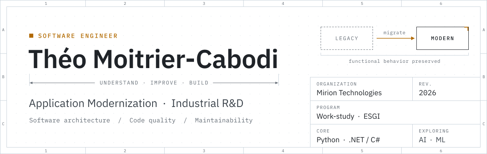

<p align="center">
<picture>
  <source media="(prefers-color-scheme: dark)" srcset="assets/header-dark.svg">
  <source media="(prefers-color-scheme: light)" srcset="assets/header-light.svg">
  
</picture>
</p>

<p align="center">
  <a href="https://tmoitrier-cabodi.dev"><b>Portfolio</b></a>
  &nbsp;&nbsp;·&nbsp;&nbsp;
  <a href="https://www.linkedin.com/in/th%C3%A9o-moitrier-cabodi-3277552b1/"><b>LinkedIn</b></a>
  &nbsp;&nbsp;·&nbsp;&nbsp;
  <a href="mailto:contact@tmoitrier-cabodi.dev"><b>Email</b></a>
</p>

<p align="center">
  <sub>
    <a href="#about-me">01&nbsp;About</a> &nbsp;/&nbsp;
    <a href="#what-i-work-on">02&nbsp;Work</a> &nbsp;/&nbsp;
    <a href="#technical-stack">03&nbsp;Stack</a> &nbsp;/&nbsp;
    <a href="#selected-engineering-interests">04&nbsp;Interests</a> &nbsp;/&nbsp;
    <a href="#engineering-approach">05&nbsp;Approach</a> &nbsp;/&nbsp;
    <a href="#github-activity">06&nbsp;Activity</a> &nbsp;/&nbsp;
    <a href="#lets-connect">07&nbsp;Contact</a>
  </sub>
</p>

<br>


## About me

I'm a French software developer working at the intersection of
**software engineering, application modernization, and industrial R&D**.

At **Mirion Technologies**, I contribute to the improvement and modernization
of existing software in demanding technical environments. I enjoy understanding
how systems actually work, identifying their weak points, and making them more
maintainable, reliable, and efficient.

<table>
  <tr>
    <td><samp>POSITION</samp></td>
    <td>Software developer · work-study program at <b>Mirion Technologies</b></td>
  </tr>
  <tr>
    <td><samp>EDUCATION</samp></td>
    <td>Studies in progress at <b>ESGI</b>, alongside the work-study program</td>
  </tr>
  <tr>
    <td><samp>CORE</samp></td>
    <td>Python development · .NET / C# development · Software architecture · Code quality and maintainability</td>
  </tr>
  <tr>
    <td><samp>EXPLORING</samp></td>
    <td>AI engineering · Machine learning</td>
  </tr>
</table>

<br>


## What I work on

<table>
  <tr>
    <td width="34%" valign="top">
      <b>Application modernization</b>
      <br>
      <sub>Improving existing applications while preserving their functional requirements.</sub>
    </td>
    <td valign="top">
      <ul>
        <li>Migrating mobile applications from Xamarin to .NET MAUI / .NET 8.</li>
        <li>Refactoring legacy code and improving software maintainability.</li>
        <li>Identifying opportunities to simplify existing implementations.</li>
        <li>Improving performance, usability, and long-term maintainability.</li>
      </ul>
    </td>
  </tr>
  <tr>
    <td width="34%" valign="top">
      <b>Python development</b>
      <br>
      <sub>Building and improving desktop tools used in technical environments.</sub>
    </td>
    <td valign="top">
      <ul>
        <li>User interface improvements.</li>
        <li>Code organization and maintainability.</li>
        <li>Performance optimization.</li>
        <li>Practical tooling for existing workflows.</li>
      </ul>
    </td>
  </tr>
  <tr>
    <td width="34%" valign="top">
      <b>Software engineering</b>
      <br>
      <sub>Developing a stronger understanding of the principles behind reliable software.</sub>
    </td>
    <td valign="top">
      <ul>
        <li>Clean code and separation of concerns.</li>
        <li>Software architecture and design patterns.</li>
        <li>Git workflows, branching strategies, and collaborative development.</li>
        <li>Debugging, testing, and controlled changes to existing systems.</li>
      </ul>
    </td>
  </tr>
</table>

<br>


## Technical stack

<p align="center">
  <samp>LANGUAGES</samp>
  <br><br>
  <picture>
    <source media="(prefers-color-scheme: light)" srcset="https://skillicons.dev/icons?i=cs,python,js,html,css,c&theme=light">
    
  </picture>
</p>

<p align="center">
  <samp>FRAMEWORKS · TOOLS · ENVIRONMENTS</samp>
  <br><br>
  <picture>
    <source media="(prefers-color-scheme: light)" srcset="https://skillicons.dev/icons?i=dotnet,git,github,azure,vscode,linux&theme=light">
    
  </picture>
</p>

<p align="center">
  <samp>CURRENTLY EXPLORING</samp>
  <br><br>
  <picture>
    <source media="(prefers-color-scheme: light)" srcset="https://skillicons.dev/icons?i=rust,go&theme=light">
    
  </picture>
</p>

<p align="center">
  <sub><i>Beyond how to use a technology, I'm interested in the trade-offs behind it:<br>
  performance, complexity, maintainability, and suitability for a given problem.</i></sub>
</p>

<br>


## Selected engineering interests

| | Area | What interests me |
|:--|:--|:--|
| `01` | **Legacy modernization** | Improving existing systems without compromising their behavior |
| `02` | **Software architecture** | Organizing code around clear responsibilities and boundaries |
| `03` | **Performance** | Understanding bottlenecks and optimizing where it matters |
| `04` | **Developer tooling** | Automating repetitive tasks and improving development workflows |
| `05` | **User experience** | Making technical applications more intuitive and efficient |
| `06` | **AI engineering** | Exploring practical applications of AI and machine learning |
| `07` | **Systems programming** | Understanding lower-level concepts through languages such as Rust |

<br>


## Engineering approach

I particularly enjoy problems where **logic, constraints, and practical usefulness**
come together. I value clear reasoning, technical consistency, and solutions that
serve a real purpose — and I prefer understanding why a solution works rather than
simply reproducing it.

1. **Understand before changing.** Explore the existing system and its constraints.
2. **Solve the actual problem.** Prefer useful, measurable improvements over unnecessary complexity.
3. **Build for maintainability.** Write code that remains understandable as a project evolves.
4. **Respect the existing system.** Modernize without losing essential behavior.
5. **Keep learning.** Challenge assumptions, explore new tools, and deepen my technical understanding.

> Good engineering is not about adding layers of complexity.
> It is about finding the simplest solution that correctly addresses the problem.

These are the questions that guide the way I approach software development and technical learning:

```text
[ ] Is this solution actually necessary?
[ ] Can the same result be achieved with less complexity?
[ ] Will another developer understand this code?
[ ] What happens when the system encounters an unexpected situation?
[ ] How can we verify that the change works as intended?
```

<br>


## GitHub activity

<p align="center">
<picture>
  <source media="(prefers-color-scheme: dark)" srcset="assets/stats-dark.svg">
  <source media="(prefers-color-scheme: light)" srcset="assets/stats-light.svg">
  
</picture>
</p>

<br>


## Let's connect

I'm interested in software engineering, application modernization,
industrial R&D, and projects where technical decisions have a concrete impact.

<p align="center">
  <a href="https://tmoitrier-cabodi.dev"><b>Portfolio</b></a>
  &nbsp;&nbsp;·&nbsp;&nbsp;
  <a href="https://www.linkedin.com/in/th%C3%A9o-moitrier-cabodi-3277552b1/"><b>LinkedIn</b></a>
  &nbsp;&nbsp;·&nbsp;&nbsp;
  <a href="mailto:contact@tmoitrier-cabodi.dev"><b>Email</b></a>
</p>

<br>

<p align="center">
  <sub><i>Understand the system. Improve what matters. Build with purpose.</i></sub>
</p>
